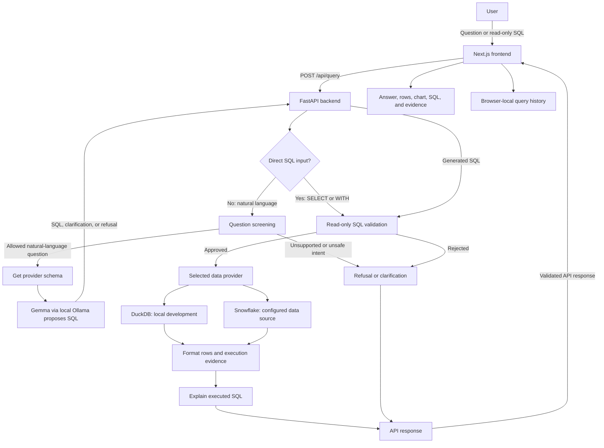

# DataMind Architecture and Workflow

## Project overview

DataMind lets users ask questions about structured data in natural language.
The backend uses the database schema to have Gemma propose SQL, validates the
SQL as read-only, and runs it through the selected data provider. The frontend
shows the result together with the SQL and supporting evidence.

## Architecture

## Request lifecycle

1. **Ask:** The user submits a natural-language question through the frontend.
   The frontend sends it to `POST /api/query`. Read-only SQL beginning with
   `SELECT` or `WITH` can also be entered directly.
2. **Screen:** For natural-language requests, the backend checks for
   modification requests, safety-bypass attempts, and unsupported forecasting
   requests. Such requests are refused before SQL generation.
3. **Discover schema:** The backend obtains the selected provider's schema.
   For natural-language requests, it formats the schema and includes likely
   join-key hints for Gemma.
4. **Generate or accept SQL:** Gemma, running through local Ollama, proposes
   SQL using the question, schema, and provider dialect. It may instead return
   a refusal or ask a clarifying question. In direct SQL mode, this generation
   step is skipped.
5. **Validate:** The backend checks the SQL before it reaches the database.
   Only one read-only `SELECT` or `WITH` statement is accepted.
6. **Execute:** The selected provider runs the approved query. DuckDB is used
   for local development; Snowflake is used when configured. Results are
   limited to 1,000 rows and marked as truncated if additional rows exist.
7. **Explain and respond:** The backend formats database values for JSON and
   derives an explanation from the SQL that actually ran. It returns the
   status, answer, SQL, rows, validation outcome, and execution metadata.
8. **Display:** The frontend validates the response against its API schemas,
   then displays the answer, result table, chart where appropriate, SQL, and
   evidence. Query history is saved in browser storage.

## Main components

| Component | Responsibility |
|---|---|
| Next.js frontend | Question entry, provider and mode selection, response validation, result visualization, and browser-local history. |
| FastAPI API | Request screening and orchestration; exposes health, schema, and query endpoints. |
| Gemma via Ollama | Proposes SQL from the question and schema; can clarify or refuse. It does not connect to the database. |
| Guardrails | Screen user intent, classify database errors, sanitize retry feedback, and bound correction attempts. |
| SQL validator | Rejects non-read-only or multi-statement SQL before execution. |
| `DataProvider` interface | Gives the API a consistent way to discover schema and execute queries across database engines. |
| DuckDB provider | Local development and testing provider. |
| Snowflake provider | Provider for configured Snowflake data, intended for the final deployment. |
| SQL explanation | Uses SQLGlot to derive tables, filters, joins, and other details from executed SQL. |
| Results formatter | Enforces the row limit and converts database values to JSON-compatible values. |

## Algorithms and techniques

### Schema formatting and join hints

The backend formats tables and columns into a compact schema description for
the model. It detects columns ending in `_id` or `_key` that occur in multiple
tables and produces likely equality-join hints. These are hints for SQL
generation, not database relationships guaranteed by metadata.

### Model-output parsing

Gemma output is parsed for a fenced SQL query, a `CANNOT_ANSWER` refusal, or a
`CLARIFY` response. Parsed SQL is still treated as untrusted and must pass
validation before execution.

### Read-only SQL validation

The validator scans SQL while distinguishing comments and quoted values from
executable tokens. It requires one `SELECT` or `WITH` statement, rejects
multiple statements and forbidden operations, and checks ambiguous quoted
strings against DuckDB and Snowflake escaping behavior. Database-level
read-only access remains essential; the validator is a guardrail, not the
security boundary.

### Screening and bounded correction

Rule-based patterns screen requests for data modification, safety bypass, and
unsupported forecasts. If generated SQL fails due to a retryable syntax or
unknown-object error, the backend can give Gemma sanitized feedback for one
corrected attempt (default `DATAMIND_GEMMA_MAX_ATTEMPTS=2`, hard maximum 3).
The corrected SQL is validated again before it runs; failed attempts are listed
in the response warnings. Unsafe SQL, permission errors and timeouts are not
retried.

### SQL-derived explanation

SQLGlot parses the SQL that was executed and derives the tables, filters,
joins, grouping, ordering, limits, and computed expressions. The explanation
does not rely on the language model's prose.

### Result limiting and serialization

The formatter fetches up to 1,001 rows to return a maximum of 1,000 and detect
truncation. It converts values such as decimals, dates, byte arrays, and
non-finite numbers into JSON-compatible representations.

### Evaluation with independent ground truth

`backend/eval/` holds 30 cases over two local fixtures (`sales`, and a
four-table `retail` dataset with foreign keys) plus optional live TPC-H cases.
Expected results come from hand-written reference SQL, never from Gemma. A
unit test re-runs each reference query against its fixture, so the stored
answers cannot drift. The runner sends each question through the real API and
compares rows regardless of column order or aliases. Results and limits are
recorded in `backend/eval/README.md`.

### Answers that follow the data

`backend/eval/data_change.py` asks a question, inserts one labeled row into an
isolated demo DuckDB file (it refuses the dev database and never touches
Snowflake), asks again, and prints both results with the difference. Because
every answer is a query executed at question time, the answer changes exactly
by the inserted row.

### Chart inference

The frontend uses a valid backend chart hint when provided. Otherwise, a
heuristic classifies columns by declared type and sampled values, then selects
a KPI for a single row, a line chart for time-based results, or bars for
categorical results. It avoids treating identifier columns as measures and
limits chart size and series for readability.

### API response validation

Zod schemas validate API responses before the UI renders them. Array-shaped
rows are normalized into objects aligned to the returned columns.

## Important design and safety points

- Gemma proposes SQL; only the backend/provider executes it.
- Both generated SQL and direct SQL pass through the read-only validation
  path.
- The real database permissions must also be read-only. Snowflake should use a
  dedicated role with only the required usage and select grants.
- Successful answers and explanations are based on query results and the SQL
  that actually ran, not invented model summaries.
- A query result is capped at 1,000 rows; the response indicates truncation.
- Demo mode is illustrative and must not be represented as a live database
  execution.
- DuckDB is for local development. Snowflake is the configured target; do not
  claim a live Snowflake integration has been verified unless live tests have
  passed against a real account.

## Likely presentation questions

The percentages below are suggested preparation priorities only; they are not
official project marks.

| Suggested weight | Likely question | Points to cover |
|---:|---|---|
| 25% | How does a question travel through the system? | Frontend → API → screening/schema → Gemma or direct SQL → validation → provider → result and evidence. |
| 20% | How do you prevent unsafe SQL from running? | Model output is untrusted; validation runs before execution; the provider also validates; database permissions must be read-only. |
| 15% | What does Gemma do, and what does it not do? | Uses the question, schema, and dialect to propose SQL or request clarification/refuse; it never accesses the database. |
| 15% | How can the same application support DuckDB and Snowflake? | Both implement the provider interface, so the API uses common schema and query methods. |
| 10% | What happens when a question is ambiguous or a query fails? | The model can ask for clarification or refuse; only eligible SQL errors get one bounded correction attempt. |
| 10% | How do you make the answer explainable? | Show the actual SQL and rows; derive the explanation from executed SQL using SQLGlot. |
| 5% | How are charts selected? | Prefer valid backend hints; otherwise infer from result columns and values, with size limits and a table fallback. |

### Short presentation summary

> DataMind translates a user's question into a read-only database query. The
> backend supplies the schema to Gemma, validates the proposed SQL, and runs
> it through a provider such as DuckDB or Snowflake. It returns the actual
> rows and a SQL-derived explanation, which the frontend presents alongside
> the query and supporting evidence.
